# BEAMTEAM

**From a published figure to a buildable, verified laser-optics bench — in under three minutes.**

BEAMTEAM is a multi-agent system (Google Gemini `gemini-4-argon`) that designs tabletop optical setups for
atomic/quantum physics labs from a natural-language goal, or reproduces them from a figure in a paper. Every
design is checked by a deterministic physics tracer — the LLMs propose, the physics disposes — then aligned,
rendered, and exported as a build kit (bill of materials, printable keyed baseplate, assembly PDF).

Built in one day at a hackathon (2026-10-25). See [Provenance](#provenance-built-today-vs-pre-existing).

**[Project page](https://elevenarms.github.io/beamline/) · [Paper (PDF)](paper/main.pdf) · [60 s demo video](demo/video/beamline_demo_60s.mp4)**

<p align="center">
  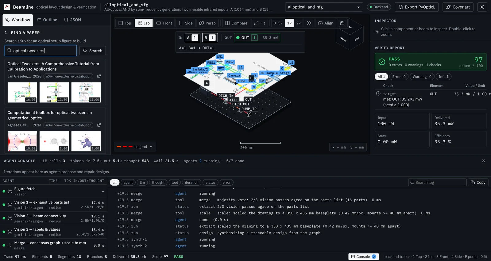
  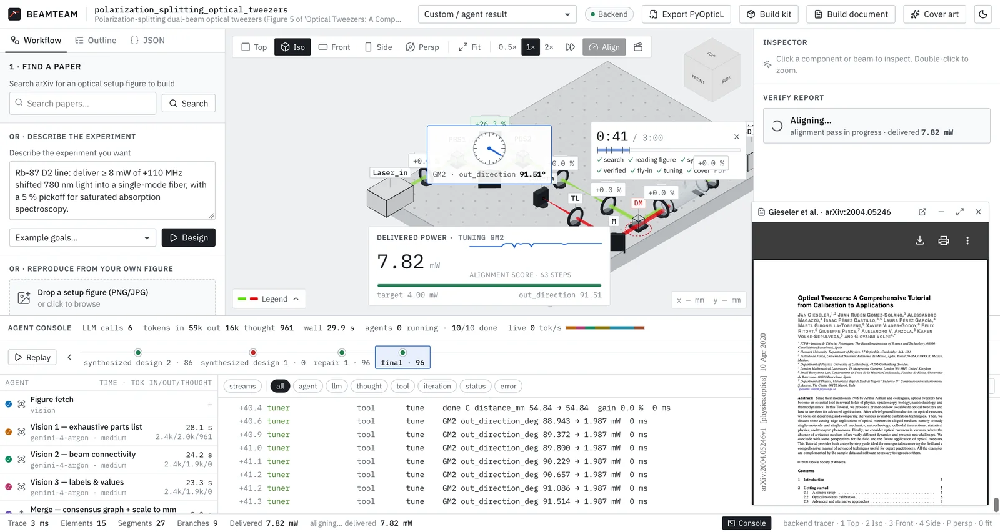
</p>
<p align="center"><sub>Left: a figure from a published paper floats above the bench while three vision agents box its parts. Right: after the parts fly in, the alignment tuner walks each knob back to optimum.</sub></p>

## Gallery

### The app

| | |
|---|---|
| 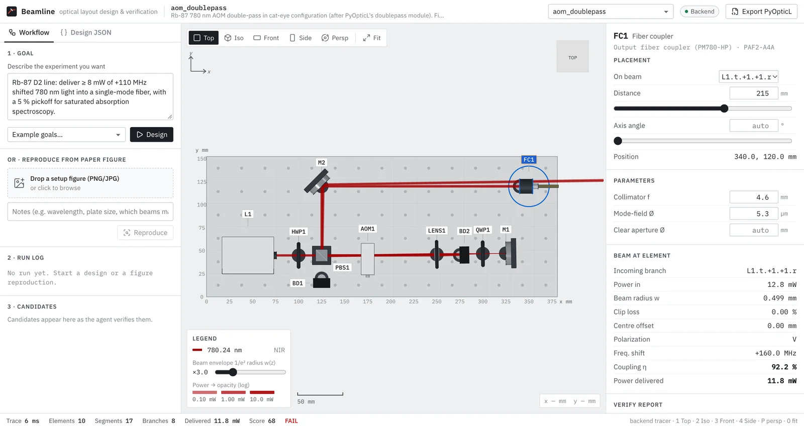 | 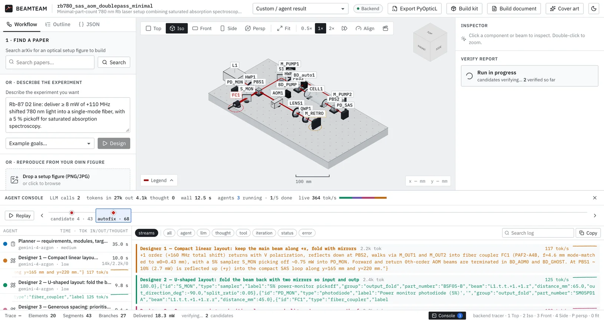 |
| **Verified layout** — Gaussian beams, polarization and power on a plan-view schematic; the verify report reads like an instrument self-test. | **Agent console** — every sub-agent (vision, synthesizers, repair…) streams its tokens live in its own colour. |
| 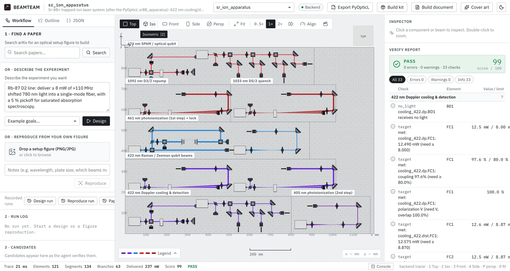 | 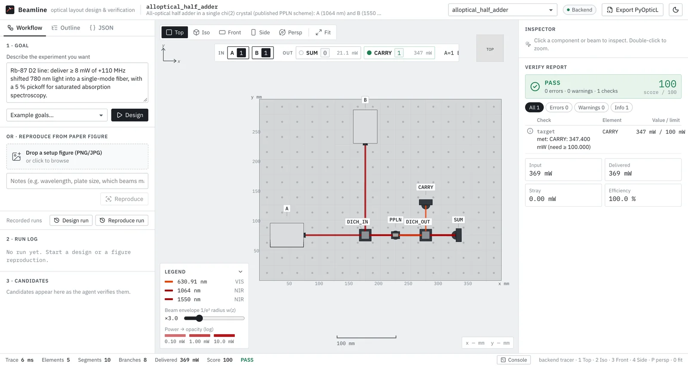 |
| **Scale** — an architect agent and parallel module agents lay out a whole trapped-ion laser table. | **Light computes** — a χ⁽²⁾ half adder: CARRY is 631 nm sum-frequency light, SUM the depleted infrared. |
| 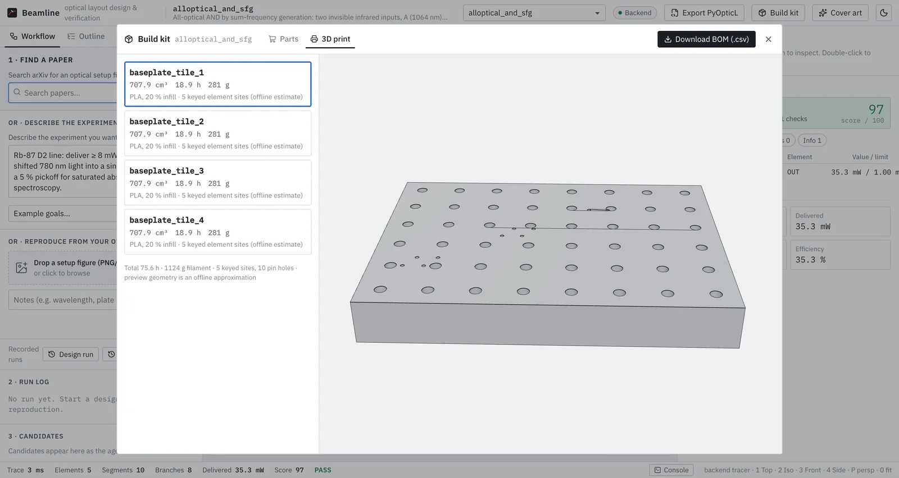 | 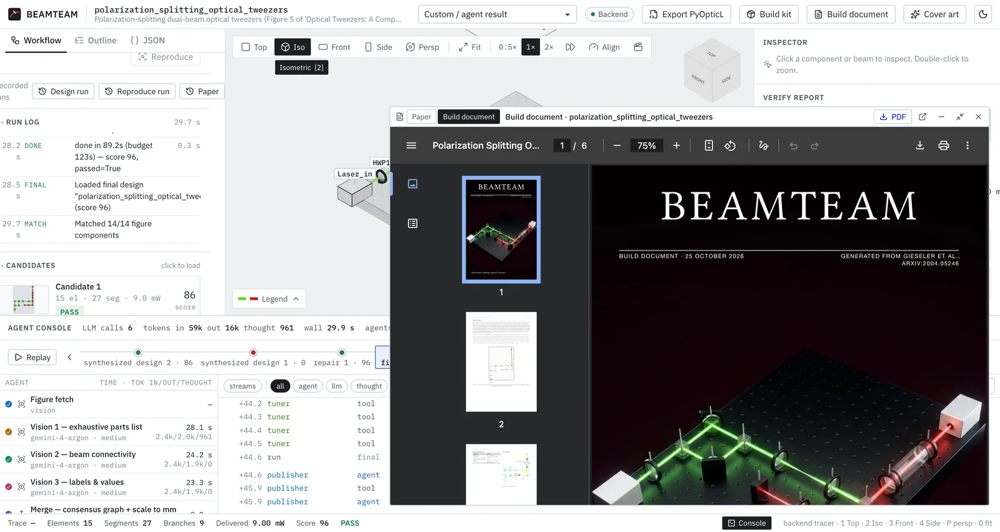 |
| **Build kit** — BOM with part numbers and watertight, keyed, tiled baseplate STLs. | **Build document** — a Typst PDF with cover, plan view, BOM, assembly steps and laser-safety notes. |

### Generated cover art (Nano Banana)

Rendered from the live 3D view plus a description of the design — *faithful* (Nano Banana 2, `gemini-3.1-flash-image`) keeps the real layout; *cinematic* (Nano Banana 2.1) stages it in a lab.

| Faithful — AOM double-pass | Faithful — all-optical half adder | Cinematic — all-optical half adder | Cinematic — AOM double-pass |
|---|---|---|---|
| 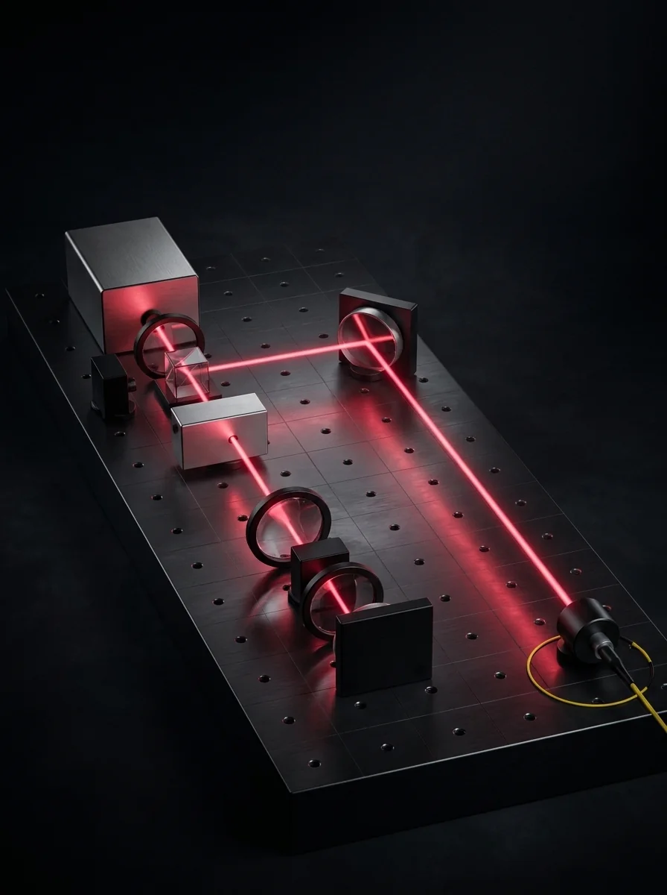 | 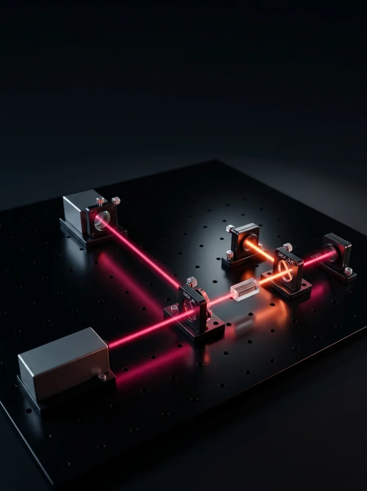 | 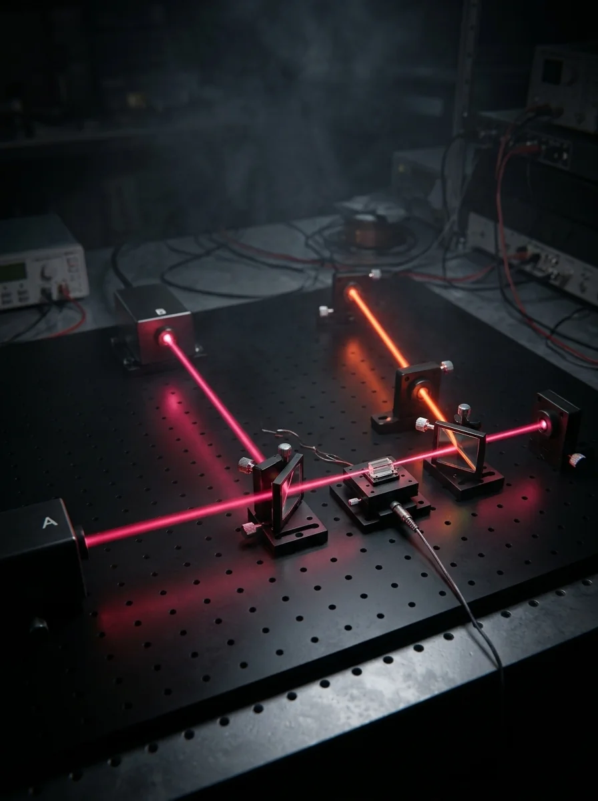 | 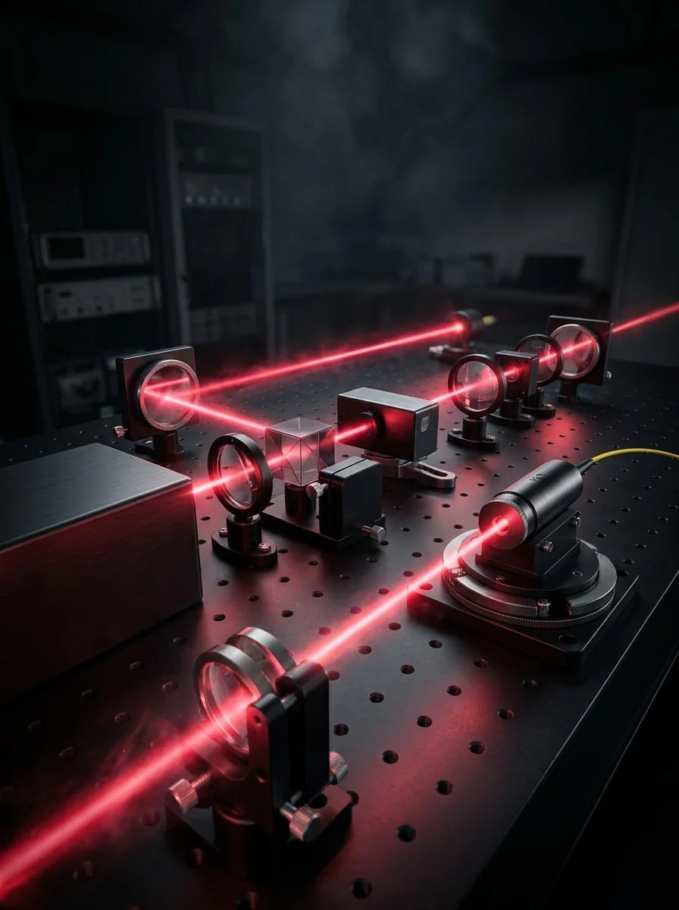 |

### Build documents

| | |
|---|---|
| 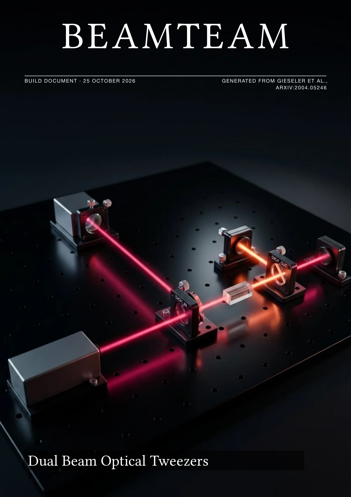 | 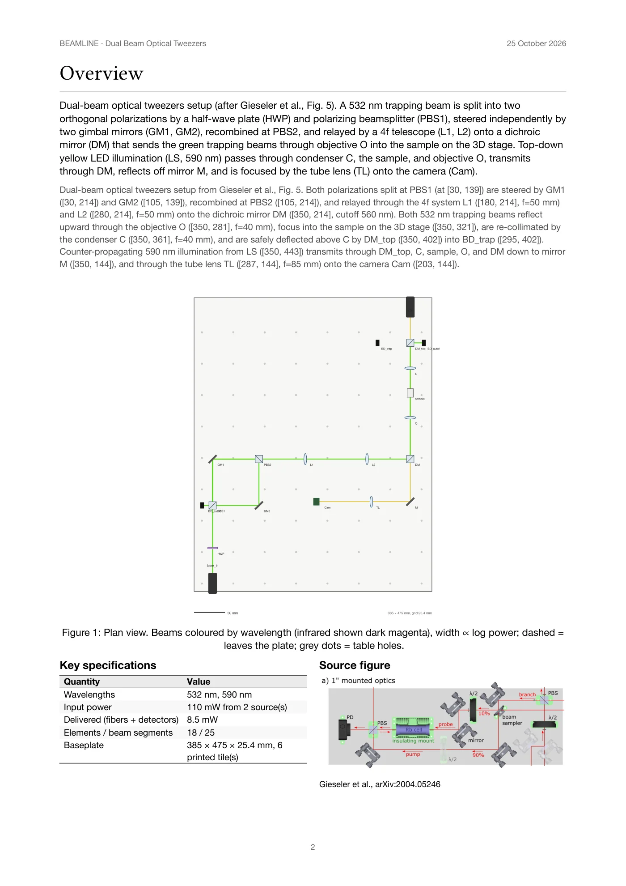 |

## What it does

1. **Find a paper** — live arXiv search; figures are ranked by how much they look like an optical setup.
2. **Read the figure** — three vision agents read it in parallel; a consensus vote + millimetre scaling turns it into a component/beam graph.
3. **Synthesize & verify** — two synthesizer agents build a design in our JSON IR; a tracer models Gaussian beams (ABCD/q), Jones polarization, power, AOM orders, fiber mode overlap and clipping; a verifier flags stray beams (laser safety), collisions, unplaced parts and unmet targets; a deterministic autofix adds validated beam dumps; a repair agent fixes the rest — all under a hard 115 s deadline.
4. **Fly-in & align** — parts drop from the drawing onto the 3D bench, beams switch on, the bench is misaligned "as built" and an alignment tuner walks every knob back to optimum.
5. **Publish** — a journal-cover render (Nano Banana 2) and a Typst **build document PDF**: cover, plan view, verification, BOM with part numbers, 3D-print list, step-by-step assembly, alignment procedure, laser-safety notes.
6. **Build kit** — `BOM.csv`, watertight tiled baseplate STLs with keyed alignment-pin holes and beam-path grooves, a PyOpticL/FreeCAD script, and an assembly README.

Also: goal → design (best-of-N candidates), hierarchical design of whole apparatus (an architect + parallel module agents with shared laser power budgets; e.g. a 121-optic Sr⁺ trapped-ion laser system), an agent console with per-agent colour-coded streaming tokens, and all-optical logic (SOA NAND, χ⁽²⁾ sum-frequency half adder).

## Measured (2026-10-25)

| | |
|---|---|
| Paper search → PDF, live, end to end | **1:37** (budget 3:00) |
| Figure → verified design (tweezers, 3 live runs) | 55 / 67 / 74 s, all PASS |
| Demo-figure reproduction reliability | 3/3 PASS, 41–55 s (concurrent) |
| Goal → verified design | ~45–85 s, scores 93–98 |
| 121-element apparatus trace + verify | ~6 ms |
| argon PyOpticL-API hallucination, zero-shot → grounded | 95 % → 0 % |
| 8-figure open-access benchmark | 4/8 reproduce pass verification (3/8 physically faithful), 4/4 goal designs pass |
| Backend tests | 123 passing |

Details and honest caveats: [`demo/DEMO.md`](demo/DEMO.md), [`demo/figures/RESULTS.md`](demo/figures/RESULTS.md).

## Run it

```bash
# API key: put a Gemini API key in ../gemini_key (one line) or export GEMINI_API_KEY
cd backend && uv sync && uv run uvicorn server:app --port 8001      # no --reload for demos
cd web && npm install && npm run build                                # backend serves web/dist
open http://localhost:8001
# dev mode: cd web && VITE_API_TARGET=http://localhost:8001 npm run dev   ·  offline mock: ?mock=1
```

Requires Python ≥ 3.12 + [uv](https://docs.astral.sh/uv/), Node ≥ 20, and [Typst](https://typst.app) on `PATH` for the PDF.

## Layout

```
backend/optics/   design IR (ir.py), tracer, verifier, autofix, tuner, merge, diff, BOM + STL, Typst build doc, PyOpticL export
backend/agents/   Gemini pipelines: design, reproduce, hierarchical, papers, cover, console events, LLM client
backend/server.py FastAPI + SSE API (see CONTRACT.md)
web/              Vite + React + three.js app (viewer, agent console, fly-in, tuning tour, build kit)
demo/             runbook, recorded runs, benchmark figures (CC BY / CC0, see demo/figures/catalog.json), renders, PDFs
paper/            LaTeX paper describing the system
```

## Provenance: built today vs pre-existing

**Built during the hackathon (2026-10-25, 11:23 → present; see `git log`)** — everything in this repository:
the design IR and API contract; the planar Gaussian-beam/Jones tracer including nonlinear elements (SOA, SFG,
saturable absorber); the verifier, autofix, alignment tuner and module merge; all agent pipelines (goal → design,
figure → design, hierarchical, paper search, cover renders, console events and token streaming); the PyOpticL
exporter; BOM, tiled STL baseplates and the Typst build document; the web application; all examples, benchmarks,
recorded runs, figures, the paper and the demo video. The code was written by an AI coding assistant (Claude Code)
and its sub-agents under the team's direction during the event.

**Pre-existing, used but not built by us:**
- [PyOpticL](https://github.com/UMassIonTrappers/PyOpticL) (Myers et al., *Quantum* 2026) — the code-to-CAD optics concept and library our exporter targets and our examples are modelled on. Not vendored; referenced only.
- Google Gemini models via API: `gemini-4-argon` (agents), Nano Banana 2 / 2.1 (`gemini-3.1-flash-image`, `gemini-nano-banana-2.1`) for renders, Gemini TTS (demo narration).
- Open-source libraries: three.js, React, @react-three/fiber, @react-three/drei, zustand, lucide-react, Vite, TypeScript; FastAPI, Pydantic, NumPy, google-genai, httpx, sse-starlette, uvicorn, manifold3d, trimesh, Pillow; Typst; ffmpeg.
- Published figures used as test inputs — open-access CC BY / CC0 figures with attribution in [`demo/figures/catalog.json`](demo/figures/catalog.json); the PyOpticL paper Fig. 2a (CC BY 4.0). Figures from other arXiv papers (e.g. Gieseler et al., arXiv:2004.05246) are fetched live at runtime and not redistributed.

## License

MIT for the code in this repository (see [LICENSE](LICENSE)). Third-party figures keep their original licenses
(see `demo/figures/catalog.json`). Prices in generated BOMs are estimates; verify with vendors. Not a substitute
for a laser-safety review.
